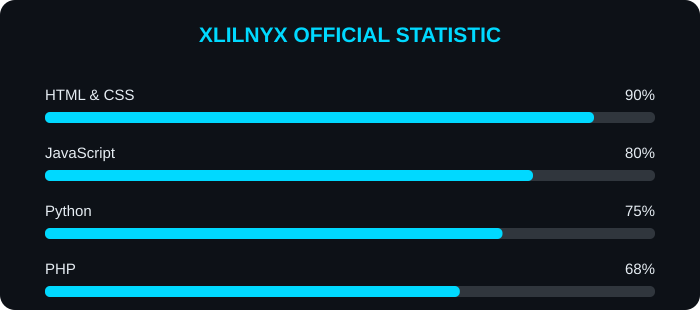

  

<h1 align="center">
  ALL ABOUT ME
   
  XLILNYX OFFICIAL
</h1>

<h3 align="center">MAHASISWA TEKNIK ELEKTRO</h3>

  ɪ'ᴍ ᴀɴ ɪɴꜰᴏʀᴍᴀᴛɪᴏɴ ᴛᴇᴄʜɴᴏʟᴏɢʏ ꜱᴛᴜᴅᴇɴᴛ ᴡʜᴏ ʟᴏᴠᴇꜱ ᴛɪɴᴋᴇʀɪɴɢ ᴡɪᴛʜ ʙᴀᴄᴋᴇɴᴅꜱ ᴀɴᴅ ᴇxᴘʟᴏʀɪɴɢ ᴛʜᴇ ᴡᴏʀʟᴅ ᴏꜰ ᴀʀᴛɪꜰɪᴄɪᴀʟ ɪɴᴛᴇʟʟɪɢᴇɴᴄᴇ. ᴍʏ ᴘʀɪᴍᴀʀʏ ꜰᴏᴄᴜꜱ ᴄᴜʀʀᴇɴᴛʟʏ ɪꜱ ʙᴀᴄᴋᴇɴᴅ ᴅᴇᴠᴇʟᴏᴘᴍᴇɴᴛ ᴜꜱɪɴɢ ʟᴀʀᴀᴠᴇʟ, ʙᴜᴛ ɪ'ᴍ ᴀʟᴡᴀʏꜱ ᴏᴘᴇɴ ᴛᴏ ʟᴇᴀʀɴɪɴɢ ɴᴇᴡ ᴛʜɪɴɢꜱ ɪɴ ᴛʜᴇ ᴛᴇᴄʜ ᴡᴏʀʟᴅ.

---

<h2 align="center">TECHNOLOGY STACK</h2>

  

---

<h2 align="center">SKILL ANALYTICS</h2>

  

---

<h2 align="center">FEATURED PROJECTS</h2>

  

  

---

<h2 align="center">GITHUB ANALYTICS</h2>

  

  

---

<h2 align="center">CURRENTLY LEARNING</h2>

  
  
  

  Always learning, building, and improving.

---

<h2 align="center">( ! ) CONTACT ME ( ! )</h2>

  
  
  
  
  

---

  

<h3 align="center">
  "Jika kau tak sanggup menahan lelahnya belajar,
  maka kau harus sanggup menahan perihnya kebodohan."
</h3>

— XLILNYX

---

  DESIGNED BY XLILNYX OFFICIAL
   
  MY SYSTEM, MY OWN WAY.

